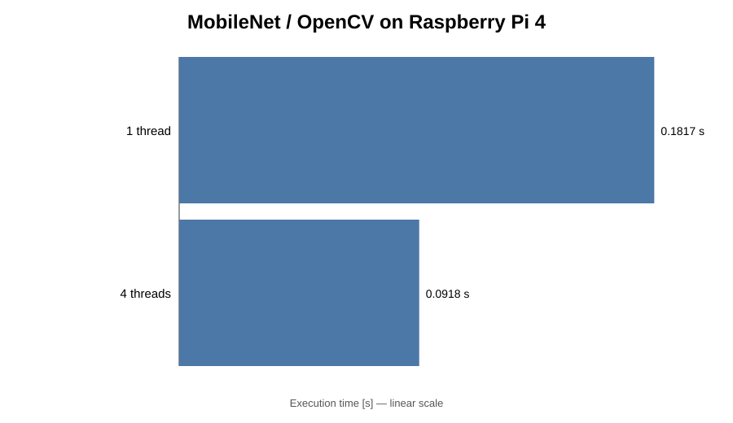

# Performance Summary: ARM CPU, FPGA Acceleration, and Raspberry Pi 4

## Purpose

This document summarizes the execution-time measurements obtained in the QNN experiments using:

- **PYNQ-Z2 ARM CPU**
- **PYNQ-Z2 FPGA acceleration**
- **Raspberry Pi 4 CPU**

The comparison currently covers:

- **DoReFa-Net / ImageNet** — notebooks `02` and `02.1`
- **MobileNet / OpenCV / ImageNet** — notebook `02.2` as an additional CPU-oriented reference
- **Tiny-YOLO** — notebooks `05` and `05.1`

A **Hailo-8 AI accelerator** section is reserved for future measurements.  
The goal is to extend this document without changing its basic structure.

> **Important:** execution times are comparable only when the same model, input, and measured scope are used.  
> MobileNet (`02.2`) is therefore presented as a separate reference and **not** as a direct speedup comparison with DoReFa-Net.

---

## 1. DoReFa-Net / ImageNet — notebooks `02` and `02.1`

### 1.1 Measured stage times

| Processing stage | PYNQ-Z2 execution | PYNQ-Z2 time [s] | Raspberry Pi 4 execution | Raspberry Pi 4 time [s] |
|---|---|---:|---|---:|
| First convolution | ARM CPU | 0.667 | CPU | 0.3524 |
| Quantized layers | FPGA | 0.057 | CPU | 66.1156 |
| Fully connected layer | ARM CPU | 0.573 | CPU | 0.1354 |
| **Measured stage sum** | **ARM + FPGA** | **1.297** | **CPU** | **66.6034** |

The PYNQ-Z2 implementation is heterogeneous: the first and final stages run on the ARM processor, while the computationally intensive quantized layers are offloaded to the FPGA.

### 1.2 Observed acceleration

Using the measured stage sums:

- PYNQ-Z2 ARM+FPGA: **1.297 s**
- Raspberry Pi 4 CPU: **66.6034 s**
- Approximate measured speedup: **51.4x**

For the quantized section alone:

- Raspberry Pi 4 CPU: **66.1156 s**
- PYNQ-Z2 FPGA: **0.057 s**
- Approximate speedup for this section: **1160x**

This result illustrates the main advantage of FPGA acceleration in this experiment: the quantized layers dominate the CPU execution time, but become a very small fraction of the processing time after FPGA offload.

---

## 2. MobileNet / OpenCV / ImageNet — notebook `02.2`

MobileNet is included as an **additional optimized CPU reference** on the Raspberry Pi 4.

| Raspberry Pi 4 configuration | Measured time [s] |
|---|---:|
| OpenCV DNN, 1 thread | 0.1817 |
| OpenCV DNN, 4 threads | 0.0918 |

Using four CPU threads reduced the measured execution time by approximately **1.98x** relative to the one-thread measurement.

### Interpretation

These values must **not** be interpreted as a direct performance comparison with DoReFa-Net. The two experiments use different neural-network architectures and different execution paths.

The MobileNet result is still valuable because it demonstrates an important point:

> **Platform acceleration is only one part of system performance. Model architecture and software optimization can have an equally important effect.**

---

## 3. Tiny-YOLO — notebooks `05` and `05.1`

### 3.1 PYNQ-Z2 measured pipeline

The `05_tiny-yolo-image.ipynb` run produced the following timing breakdown:

| Processing stage | Execution resource | Measured time [s] |
|---|---|---:|
| First convolution + quantization | ARM CPU | 1.726 |
| Quantized-layer offload | FPGA | 0.593 |
| Last convolution | ARM CPU | 0.065 |
| Decode + draw + file I/O | ARM CPU | 1.964 |
| **Sum of measured stages** | **ARM + FPGA** | **4.347** |

The test image produced the following detections:

| Object | Confidence |
|---|---:|
| person | 97% |
| sheep | 96% |
| dog | 85% |
| sheep | 43% |

### 3.2 Raspberry Pi 4 comparison

For the corresponding Raspberry Pi 4 reference notebook `05.1_tiny-yolo-image-rpi.ipynb`, the measured execution time was:

- **274.349 s**

Compared with the PYNQ-Z2 measured stage sum:

| Platform | Execution type | Measured time [s] |
|---|---|---:|
| PYNQ-Z2 | ARM + FPGA | 4.347 |
| Raspberry Pi 4 | CPU | 274.349 |

The ratio is approximately:

**274.349 / 4.347 = 63.1x**

Thus, for the measurements currently available, the PYNQ-Z2 heterogeneous pipeline is approximately **63.1x faster** than the Raspberry Pi 4 CPU implementation.

> This speedup should be described as a comparison of the **currently measured execution scopes**.  
> Before treating it as a strict end-to-end benchmark, both notebooks should use exactly the same timing boundaries.

---

## 4. Current comparison overview

| Experiment | Model | PYNQ-Z2 ARM | PYNQ-Z2 FPGA / ARM+FPGA | Raspberry Pi 4 | Hailo-8 |
|---|---|---|---|---|---|
| `02` / `02.1` | DoReFa-Net | ARM stages measured | **1.297 s measured stage sum** | **66.6034 s measured stage sum** | To be measured |
| `02.2` | MobileNet / OpenCV | — | — | **0.1817 s (1 thread)** / **0.0918 s (4 threads)** | Future reference if applicable |
| `05` / `05.1` | Tiny-YOLO | ARM stages measured | **4.347 s measured stage sum** | **274.349 s** | To be measured |

---

## 5. Main conclusions

The experiments demonstrate three important characteristics of embedded neural-network inference.

### FPGA acceleration is most effective when computationally intensive layers can be offloaded

In the DoReFa-Net experiment, the quantized layers require **66.1156 s** on the Raspberry Pi 4 CPU but only **0.057 s** on the PYNQ-Z2 FPGA in the measured implementation. The remaining ARM stages then become a significant part of the total execution time.

### The complete application is a heterogeneous pipeline

Neither the DoReFa-Net nor the Tiny-YOLO PYNQ-Z2 experiment is an “FPGA-only” execution. Pre-processing, selected layers, post-processing, drawing, and file I/O may still execute on the ARM processor.

Therefore, accelerator performance alone does not determine the final application latency.

### Model architecture matters

The MobileNet/OpenCV experiment shows that an efficient model combined with an optimized CPU implementation can achieve very low inference times on the Raspberry Pi 4.

Because MobileNet and DoReFa-Net are different networks, these numbers are **not directly comparable**, but they provide an important architectural reference.

---

## 6. Planned extension: Hailo-8

The next version of this comparison will add measurements obtained with the **Hailo-8 AI accelerator**.

Where possible, the same evaluation should record:

| Metric | ARM / CPU | FPGA | Hailo-8 |
|---|---:|---:|---:|
| Latency per image | ✓ | ✓ | planned |
| Throughput / FPS | ✓ where meaningful | ✓ | planned |
| Model and precision | ✓ | ✓ | planned |
| Host preprocessing time | ✓ | ✓ | planned |
| Accelerator execution time | — | ✓ | planned |
| Post-processing time | ✓ | ✓ | planned |
| End-to-end time | ✓ | ✓ | planned |
| Power / energy efficiency | optional | optional | planned if measurable |

This will allow the laboratory to evolve from a simple timing comparison into a broader study of **CPU, FPGA, and dedicated AI-accelerator architectures for edge inference**.

---

## Measurement note

For future experiments, all platforms should use identical timing boundaries whenever a direct speedup is reported. Ideally, each benchmark should separately record:

1. preprocessing,
2. accelerator/model execution,
3. post-processing,
4. total end-to-end latency.

This prevents model-loading time, image I/O, visualization, or other host operations from being unintentionally included in only one platform's measurement.
