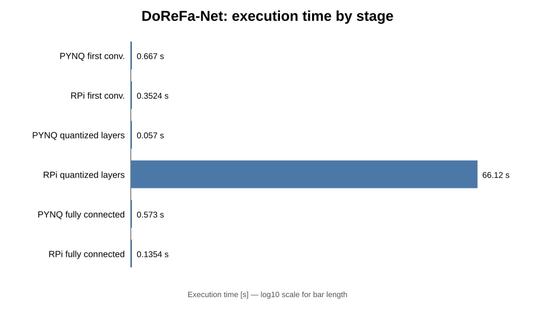
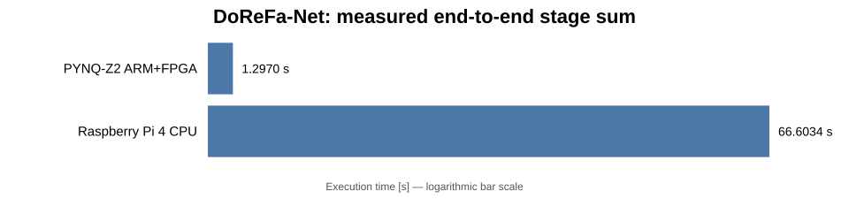
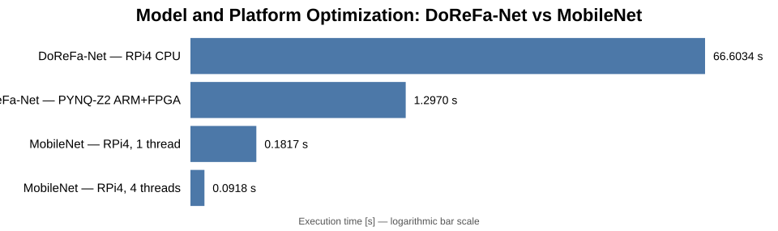
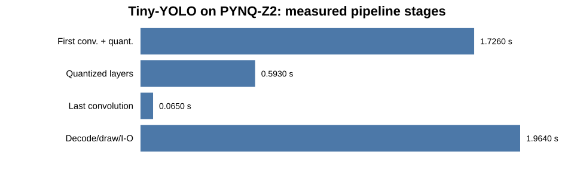
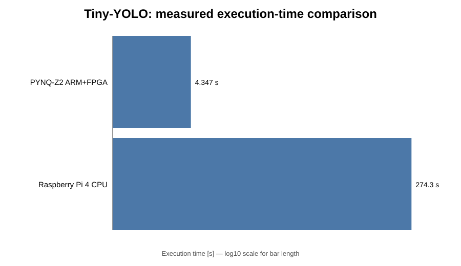

# Performance Summary: ARM CPU, FPGA Acceleration, and Raspberry Pi 4

## Purpose

This document summarizes the execution-time measurements obtained in the QNN experiments using:

- **PYNQ-Z2 ARM CPU**
- **PYNQ-Z2 FPGA acceleration**
- **Raspberry Pi 4 CPU**

The comparison currently covers:

- **DoReFa-Net / ImageNet** — notebooks `02` and `02.1`
- **MobileNet / OpenCV / ImageNet** — notebook `02.2` as an optimized CPU reference
- **Tiny-YOLO** — notebooks `05` and `05.1`

A **Hailo-8 AI accelerator** section is reserved for future measurements.

> **Important:** execution times are directly comparable only when the same model, input, and timing scope are used.  
> MobileNet (`02.2`) is therefore presented as a system-level reference, not as a direct model-to-model benchmark against DoReFa-Net.

---

## 1. DoReFa-Net / ImageNet — PYNQ-Z2 and Raspberry Pi 4

The first experiment evaluates the same DoReFa-Net ImageNet model on two different embedded platforms.

On the PYNQ-Z2, the inference pipeline is heterogeneous: the first convolution and the final fully connected layer are executed on the ARM processor, while the computationally intensive quantized layers are offloaded to the FPGA.

To establish a software reference, the same model was also executed on the Raspberry Pi 4 using the CPU only.

The objective of this experiment is therefore to compare:

- CPU execution on the Raspberry Pi 4,
- ARM processing on the PYNQ-Z2,
- FPGA acceleration of the quantized layers,
- and the resulting heterogeneous ARM+FPGA execution time.

### 1.1 Measured stage times

| Processing stage | PYNQ-Z2 execution | PYNQ-Z2 time [s] | Raspberry Pi 4 time [s] |
|---|---|---:|---:|
| First convolution | ARM CPU | 0.667 | 0.3524 |
| Quantized layers | FPGA | 0.057 | 66.1156 |
| Fully connected layer | ARM CPU | 0.573 | 0.1354 |
| **Measured stage sum** | **ARM + FPGA** | **1.297** | **66.6034** |

### 1.2 Performance comparison

The measurements show that most of the execution time of the software implementation is concentrated in the quantized layers.

On the Raspberry Pi 4, these layers require **66.1156 s**, whereas the FPGA implementation on the PYNQ-Z2 executes the corresponding stage in only **0.057 s**.

The complete measured pipeline requires:

- **66.6034 s** on the Raspberry Pi 4,
- **1.297 s** on the PYNQ-Z2 ARM+FPGA implementation.

This corresponds to an overall measured speedup of approximately **51.4x**.

For the quantized layers alone, the measured acceleration is approximately **1160x**.

---

## 2. MobileNet / OpenCV — Searching for a More Efficient CPU Model

The previous experiment demonstrated that FPGA acceleration can provide a very large speedup for a quantized neural network. However, it also raises another important question:

> Can a more efficient neural-network architecture achieve competitive performance on the Raspberry Pi 4 without FPGA acceleration?

To investigate this, a second model was selected: **MobileNet**, executed using the OpenCV DNN framework on the Raspberry Pi 4.

MobileNet was specifically designed for efficient inference on resource-constrained devices. Therefore, this experiment is not intended as a direct model-to-model benchmark against DoReFa-Net. Instead, it evaluates how much performance can be gained simply by choosing a more computationally efficient neural-network architecture and an optimized CPU implementation.

### 2.1 Performance comparison

| Model / configuration | Platform | Execution time [s] |
|---|---|---:|
| DoReFa-Net | Raspberry Pi 4 CPU | 66.6034 |
| DoReFa-Net | PYNQ-Z2 ARM+FPGA | 1.297 |
| MobileNet, 1 thread | Raspberry Pi 4 CPU | 0.1817 |
| MobileNet, 4 threads | Raspberry Pi 4 CPU | 0.0918 |

The MobileNet implementation is dramatically faster than the CPU implementation of DoReFa-Net on the same Raspberry Pi 4.

More importantly, the optimized four-thread MobileNet implementation is also faster in absolute execution time than the measured DoReFa-Net ARM+FPGA pipeline on the PYNQ-Z2.

This comparison must be interpreted carefully because the neural networks are different. Nevertheless, it illustrates an important architectural lesson:

> **Performance depends not only on the hardware accelerator, but also on the neural-network architecture and the efficiency of the software implementation.**

The comparison therefore demonstrates two complementary optimization strategies:

- accelerate a computationally demanding quantized model using FPGA hardware;
- or select a lightweight model specifically designed for efficient CPU inference.

---

## 3. Tiny-YOLO — Object Detection on PYNQ-Z2 and Raspberry Pi 4

The previous experiments focused on image classification. The next experiment extends the comparison to a more computationally demanding computer-vision task: **object detection**.

Tiny-YOLO performs both object localization and classification and therefore represents a significantly more complex inference pipeline.

As with DoReFa-Net, the PYNQ-Z2 implementation uses heterogeneous processing:

- initial processing is performed on the ARM processor,
- the quantized neural-network layers are accelerated in the FPGA,
- the final convolution and result decoding are executed on the ARM processor.

The same object-detection experiment was also executed on the Raspberry Pi 4 using CPU-based processing.

### 3.1 PYNQ-Z2 execution breakdown

| Processing stage | Execution resource | Measured time [s] |
|---|---|---:|
| First convolution + quantization | ARM CPU | 1.726 |
| Quantized layers | FPGA | 0.593 |
| Last convolution | ARM CPU | 0.065 |
| Decode + draw + file I/O | ARM CPU | 1.964 |
| **Measured stage sum** | **ARM + FPGA** | **4.347** |

The test image produced detections for the expected object classes, including person, sheep, and dog.

### 3.2 Raspberry Pi 4 comparison

The corresponding Raspberry Pi 4 execution required **274.349 s**, while the measured PYNQ-Z2 ARM+FPGA pipeline required **4.347 s**.

This corresponds to a measured ratio of approximately:

**274.349 / 4.347 ≈ 63.1x**

The result confirms the same trend observed with DoReFa-Net: the computationally intensive neural-network layers benefit strongly from FPGA acceleration.

At the same time, the timing breakdown shows that non-accelerated operations such as preprocessing, decoding, visualization, and file I/O can become a significant fraction of the complete application latency.

---

## 4. Current comparison overview

| Experiment | Model | PYNQ-Z2 ARM / FPGA | Raspberry Pi 4 | Hailo-8 |
|---|---|---|---|---|
| `02` / `02.1` | DoReFa-Net | **1.297 s measured stage sum** | **66.6034 s measured stage sum** | To be measured |
| `02.2` | MobileNet / OpenCV | — | **0.1817 s (1 thread)** / **0.0918 s (4 threads)** | Future reference if applicable |
| `05` / `05.1` | Tiny-YOLO | **4.347 s measured stage sum** | **274.349 s** | To be measured |

---

## 5. Main conclusions

The experiments demonstrate three important characteristics of embedded neural-network inference.

### FPGA acceleration is most effective when computationally intensive layers can be offloaded

In the DoReFa-Net experiment, the quantized layers require **66.1156 s** on the Raspberry Pi 4 CPU but only **0.057 s** on the PYNQ-Z2 FPGA in the measured implementation. The remaining ARM stages then become a significant part of the total execution time.

### The complete application is a heterogeneous pipeline

Neither the DoReFa-Net nor the Tiny-YOLO PYNQ-Z2 experiment is an “FPGA-only” execution. Pre-processing, selected layers, post-processing, drawing, and file I/O may still execute on the ARM processor.

Therefore, accelerator performance alone does not determine the final application latency.

### Model architecture matters

The MobileNet/OpenCV experiment shows that an efficient model combined with an optimized CPU implementation can achieve very low inference times on the Raspberry Pi 4.

Because MobileNet and DoReFa-Net are different networks, these numbers are **not directly comparable**, but they provide an important architectural reference.

---

## 6. Planned extension: Hailo-8

The next version of this comparison will add measurements obtained with the **Hailo-8 AI accelerator**.

Where possible, the same evaluation should record:

| Metric | ARM / CPU | FPGA | Hailo-8 |
|---|---:|---:|---:|
| Latency per image | ✓ | ✓ | planned |
| Throughput / FPS | ✓ where meaningful | ✓ | planned |
| Model and precision | ✓ | ✓ | planned |
| Host preprocessing time | ✓ | ✓ | planned |
| Accelerator execution time | — | ✓ | planned |
| Post-processing time | ✓ | ✓ | planned |
| End-to-end time | ✓ | ✓ | planned |
| Power / energy efficiency | optional | optional | planned if measurable |

This will allow the laboratory to evolve from a simple timing comparison into a broader study of **CPU, FPGA, and dedicated AI-accelerator architectures for edge inference**.

---

## Measurement note

For future experiments, all platforms should use identical timing boundaries whenever a direct speedup is reported. Ideally, each benchmark should separately record:

1. preprocessing,
2. accelerator/model execution,
3. post-processing,
4. total end-to-end latency.

This prevents model-loading time, image I/O, visualization, or other host operations from being unintentionally included in only one platform's measurement.
